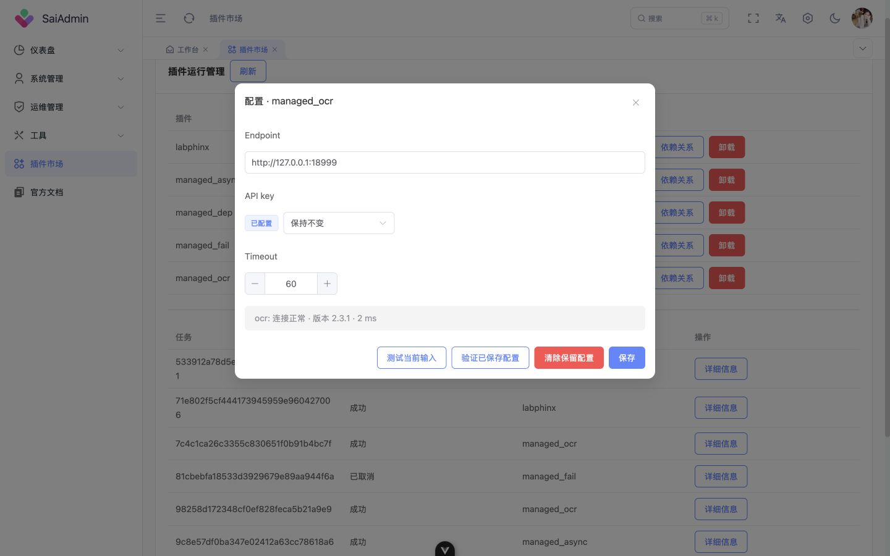
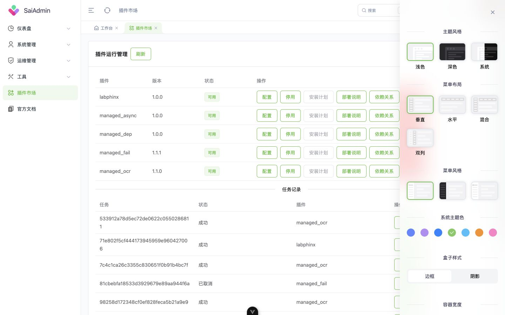

# 验证记录

日期：2026-11-16。仅在一次性本地环境验证，未合并、发布或部署到用户业务系统。

## 基线与环境

- 本次实现提交：a89c584（后续文档提交不改变运行代码）。
- saipackage 基线：6.x，a8cb24f76b29b1bc7b1b94c426c7471168e5bfa2。
- 官方 SaiAdmin 宿主：saithink/saiadmin6.x，b697986e7838dab87463c7597b2787cb3c0d1a7d；实际解析 SaiAdmin 6.1.5、Phinx 0.16.12、Webman 2.2.5（以实验室 composer.lock 为准）。
- 本机 PHP 8.4.26；隔离 PHP 8.4.27。MySQL 8.4、PostgreSQL 17 两套独立 Compose 项目，各自独立数据库卷、网络、可写源码和 Redis。
- 最终测试项目：sai6lab-kvns2rct（MySQL）和 sai6lab-tpe_yzmn（PostgreSQL）；另用全新 sai6lab-zrmcw57f 直接首装 1.1.0。早期探索环境未作为最终首装证据。
- Docker 只用于本次测试宿主及数据库隔离；被测安装器没有调用 Docker，模拟外部服务由测试脚本手动启动。

## 已执行结果

| 检查 | 结果 | 范围与证据 |
| --- | --- | --- |
| PHP 8.1 / 8.4 CI | 通过 | [实现提交的 CI 运行](https://github.com/guozhijian611/saipackage/actions/runs/43738758352)；最终分支检查见 PR |
| PHP 领域测试 | 通过 | composer test：33 tests / 61 assertions |
| PHP 语法及 Composer 配置 | 通过 | php -l、composer validate、git diff --check |
| 两库管理表初始化 | 通过 | 真实 Phinx 迁移；不是手工建表替代 |
| 两库首次 ZIP 安装 | 通过 | 缺依赖阻止、补齐包后拓扑排序、任务成功、服务未部署仍安装成功并待配置 |
| 新版直接首装 | 通过 | 第三套空宿主直接安装 1.1.0；note 列存在、无保留配置、显示待配置 |
| 同版重复上传 | 通过 | 拒绝且已有安装可用 |
| 升级 | 通过 | 1.0.0 → 1.1.0，上传不覆盖已安装版本；业务记录保留、废弃文件删除、配置保留 |
| 卸载再安装 | 通过 | 两库均验证 rollback、文件删除及新包重装；加密配置保留并复用 |
| 故意失败及修复 | 通过 | 失败迁移标记 needs_attention，功能被拦截；取消旧任务、修正版经新 PHP 进程恢复成功 |
| 旧包兼容 | 通过 | labphinx-1.0.0 无 manifest/schema 的 ZIP 在两库均安装并保持可用 |
| 真实后台执行 | 通过 | enqueue 请求仅创建任务；实际 management worker 完成任务，持久化 database 等阶段并触发重载 |
| HTTP 权限与配置 | 通过 | 匿名 401、非超级管理员 403；GET 脱敏、保存、409 修订冲突、草稿/保存后检测 |
| 错误响应与日志脱敏 | 通过 | debug 开启时错误响应无 request_param/trace/测试密钥；日志检索无测试凭据 |
| 业务入口保护 | 通过 | 停用后业务 HTTP 503，服务验证并启用后恢复；实际重载后返回 1.1.0 |
| 真实 HTTP 服务探测 | 通过 | OK、AUTH_FAILED、VERSION_UNSUPPORTED、CAPABILITY_MISSING、UNREACHABLE、TIMEOUT；两库独立服务，超时测试真实等待 5 秒 |
| 前端构建与类型 | 通过 | 官方宿主 pnpm build（vue-tsc + Vite）；新组件随 setup 复制 |
| 浏览器操作 | 通过 | 正常管理员登录、配置表单、保持密钥、保存超时参数、草稿/保存后验证、可用状态展示 |
| 主题与语言 | 通过 | 明暗主题、绿色主题色跟随宿主；中英文不刷新切换；最后恢复原主题和中文 |

逻辑层生命周期使用 install(false)/uninstall(false)，避免在 CLI 中发送重启信号；其本身不证明真实重载。另行使用实际后台 worker、Webman reload 和 HTTP 返回版本验证重载，不将容器存活当作业务成功。

前端首次单独执行 vue-tsc 时宿主尚未生成自动导入声明，出现宿主范围的未定义 ref 等错误；运行正常 Vite 流程生成声明后，最终完整 pnpm build 通过。开发中的代理端口和热更新报错已解决，最终页面加载、配置和检测请求成功。

## 重现方式

1. 从上述官方基线建立独立宿主，把当前包作为 Composer path repository（版本映射 6.2.0），安装依赖；同步 src/plugin/saipackage 到工作副本。
2. 使用 saiadmin6-plugin 技能的 lab.py 创建每轮独立 MySQL/PG 环境。初始化核心并运行 PureSeeder；生成稳定配置密钥，执行 saipackage:setup，再启用 management 并重启。
3. `python3 tests/build_fixtures.py OUTPUT` 生成 ZIP，将 ZIP 和 tests/*.php 放入宿主 server/tests；将 ZIP 放在 server/tests/fixtures。测试宿主配置 drain 回调为 true（这些夹具没有运行中业务任务）。
4. 每个阶段使用独立 PHP 进程，依次运行 `php tests/lifecycle.php install`、upgrade、uninstall、failure、recover_failure。另外在第三套空宿主运行 direct 阶段，直接安装 1.1.0，验证完整迁移和空配置。
5. 手动启动 `php -S 127.0.0.1:18999 tests/mock_health.php`。逻辑测试后执行真实 Webman reload，再运行 http.php 和 probes.php。HTTP 脚本仅在测试宿主使用正常 JWT 签发器生成测试令牌，鉴权中间件保持开启；浏览器登录另行完成正常验证码流程。
6. background.php enqueue 创建异步任务，另进程 background.php poll 检查实际 worker。此测试只运行一次；需要复测时用新环境或按正常卸载流程移除 managed_async。
7. 旧包检查由技能 build_example.py 生成 labphinx-1.0.0.zip，再执行 legacy.php。

夹具源码和独立构建器在 tests/，不作为用户业务插件发布。ZIP 使用固定时间戳生成，可重复核对 SHA256；安装器另对解压载荷计算指纹。

## 明确边界

- 当前开放实例级配置；租户作用域需要未来的宿主身份/授权适配，现阶段明确拒绝。
- 当前使用单机持久 runtime 目录和文件锁，不支持多个独立主机同时调度。
- Composer/npm 延续既有终端安装流程，waiting_dependencies 需完成库安装后确认任务；不承诺自动解决 npm 版本冲突。
- HTTP 控制器及按插件注册的路由自动保护；宿主自定义主应用路由、队列、定时任务必须调用 RuntimeGuard，无法自动识别任意第三方业务入口。
- 卸载排空由宿主 drain 回调证明。未提供时拒绝实际卸载。
- 不提供数据库/文件/依赖的原子回滚，不声称可以自动恢复所有部分执行的 SQL。未实测真实客户外部服务和生产部署。
- 前端浏览器测试针对官方 6.x 宿主；自定义宿主需按接入指南复验。PHP 8.1 和 8.4 均已实际运行 CI，发布前仍应核对 PR 最终提交的检查状态。

## 截图

## 本地验收保留

保留 MySQL 测试宿主及前端：http://127.0.0.1:18180/#/plugin，后端仅监听 http://127.0.0.1:18182。其余已记录的临时 Compose 项目在完成验证后清理；保留各自临时目录作本地证据，不上传凭据。此地址依赖本机开发进程，不能作为生产服务使用。
